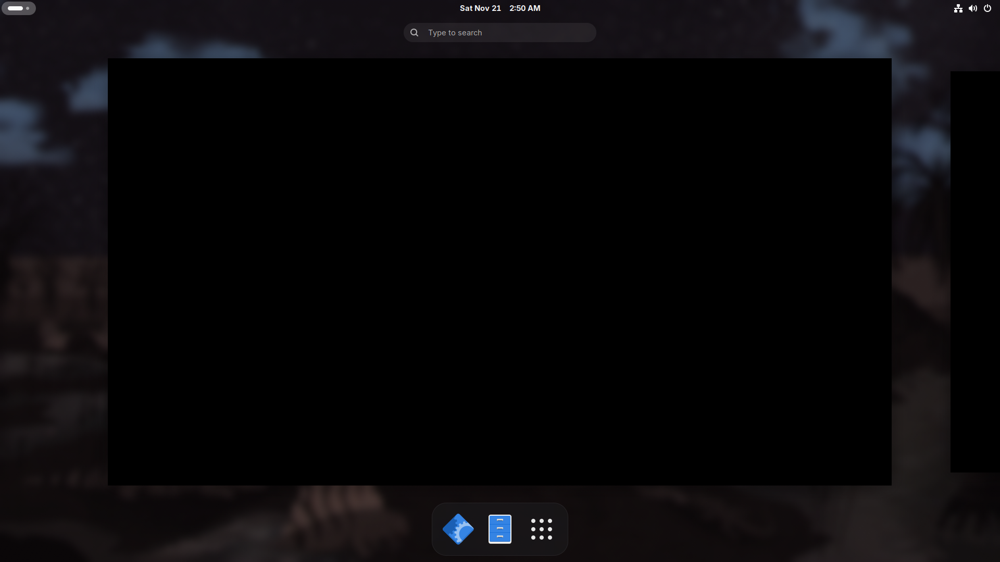
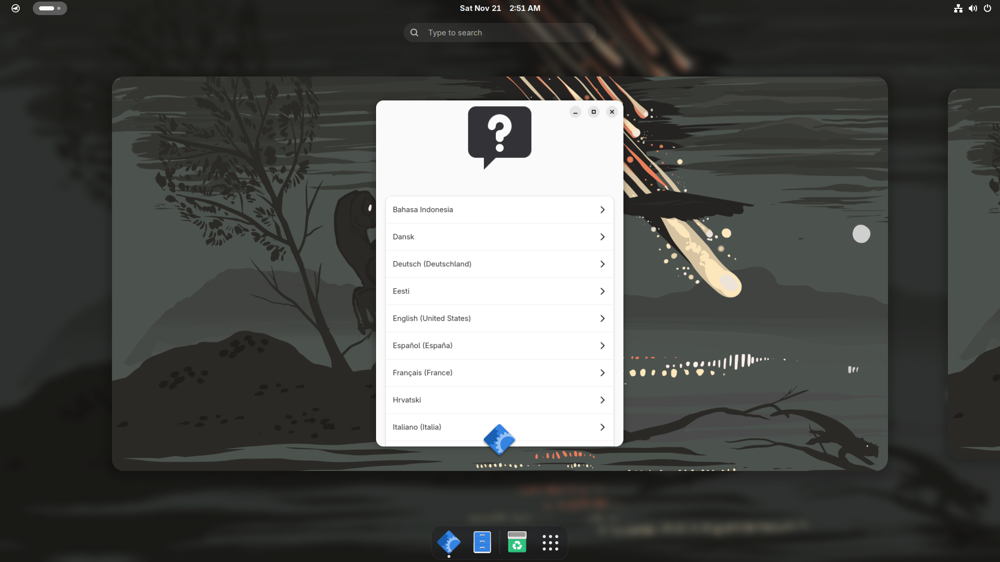

# Evidence for projectbluefin/utah#1399 (raw-image install spike)

Screenshots and logs from CI runs of `.github/workflows/raw-installer-spike.yml` on hanthor/utah.

## Run [44857364700](https://github.com/hanthor/utah/actions/runs/44857364700)

| Screenshot | What it proves |
|---|---|
|  `00-grub-menu.png` | Firmware → shim → GRUB on the raw medium boots the default "Utah Live (try or install)" BLS entry |
|  `01-live-session.png` | The installed-disk image booted as live media (`ro utah.live`, tmpfs overlay, SELinux **enforcing**, medium attached read-only) reaches a GNOME session for the live user, with OS-Installer autostarted |
|  `02-installer-language.png` | OS-Installer (hanthor/os-installer `utah` config) running in the live session, language page |
|  `fail-final.png` | Where the run stopped: the harness could not activate a list row through AT-SPI (GTK 4 exposes no row actions or GrabFocus), fixed in later runs by keyboard navigation |

`live-facts.txt` shows `/sysroot` as an overlay over the read-only `vda3`, the composefs root, `getenforce` = Enforcing and `vda` RO=1.
