# Evidence for projectbluefin/utah#1399 (raw-image install spike)

Screenshots and logs from CI runs of `.github/workflows/raw-installer-spike.yml` on hanthor/utah. The spike is GNOME OS-style
install for Utah: one shipped bootc disk image boots live with `utah.live`, and OS-Installer installs it by block copy into LUKS2.
bootc keeps handling updates.

## Result: every stage passes

Run [44866213203](https://github.com/hanthor/utah/actions/runs/44866213203): both the `gui` and `script` jobs pass. The images
below are from the `gui` job.

| Stage | Status | Screenshot |
|---|---|---|
| Firmware → shim → GRUB on the raw medium, default "Utah Live" entry | ✅ | 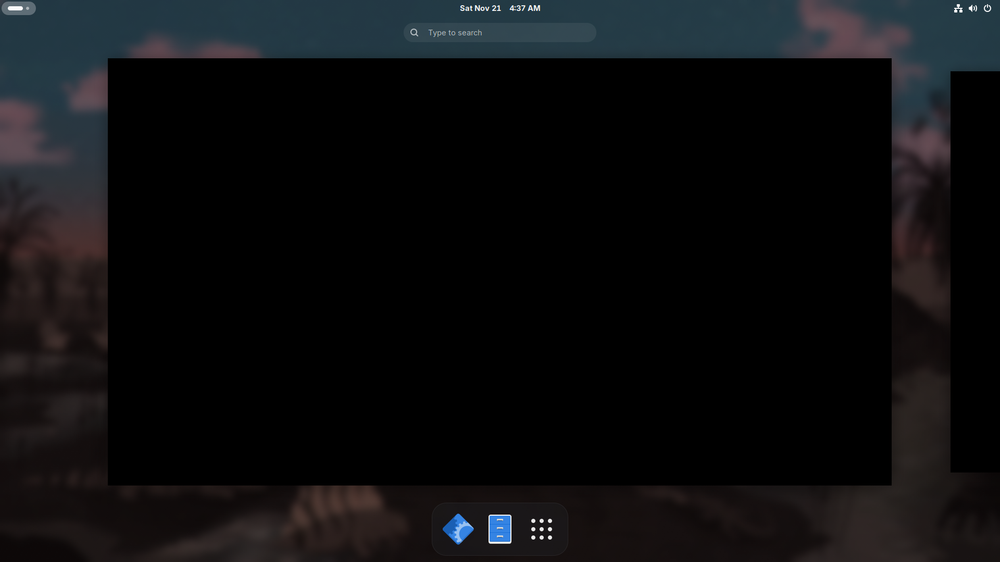 |
| Live session from the read-only medium (tmpfs overlay, SELinux enforcing), OS-Installer autostarted | ✅ |  |
| Installer: language | ✅ | 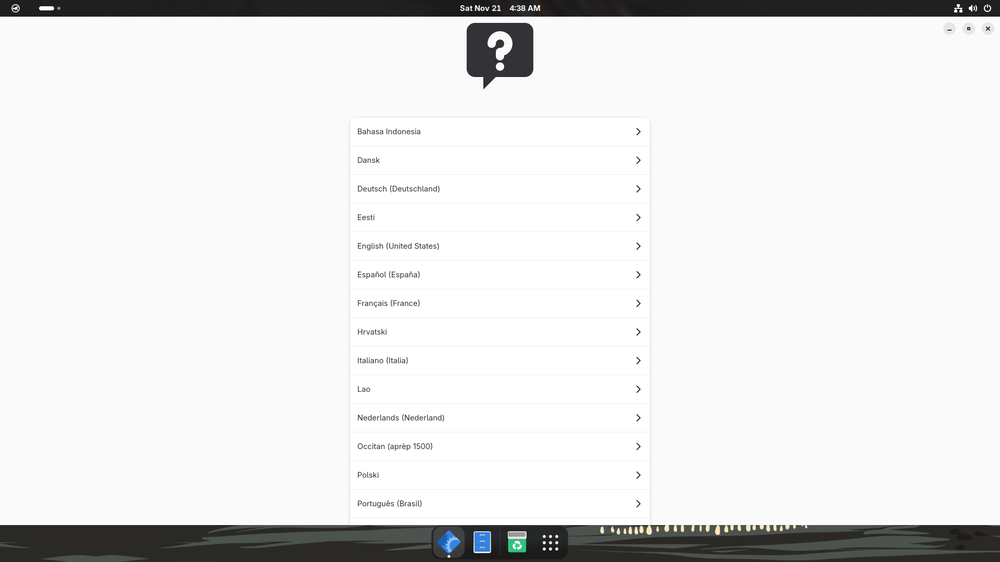 |
| Installer: welcome (Utah logo) | ✅ | 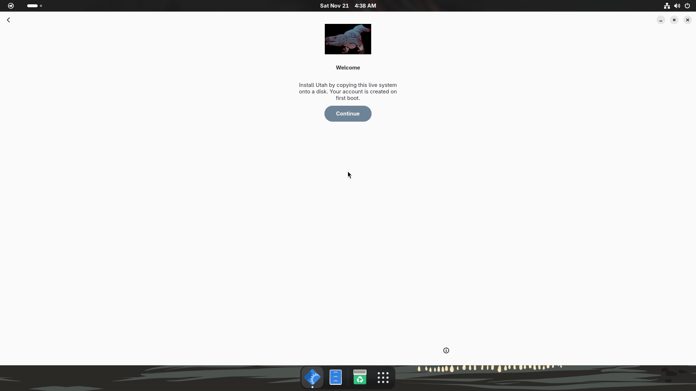 |
| Installer: keyboard | ✅ | 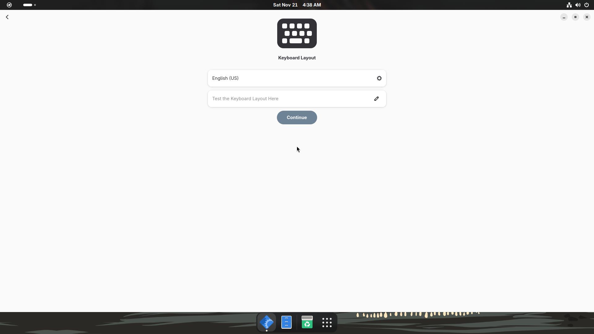 |
| Installer: disk (48 GB target; 24 GB medium greyed out) | ✅ | 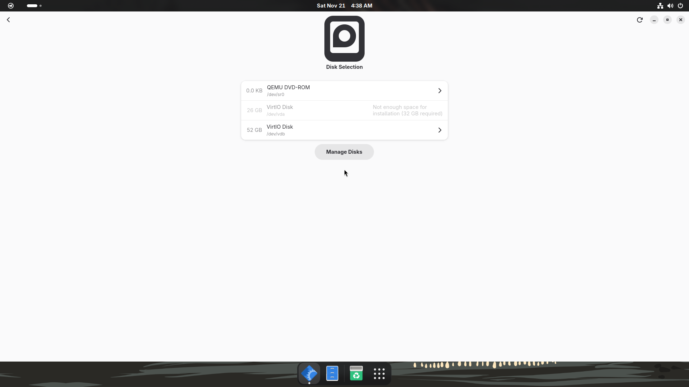 |
| Installer: encryption on, passphrase typed twice | ✅ | 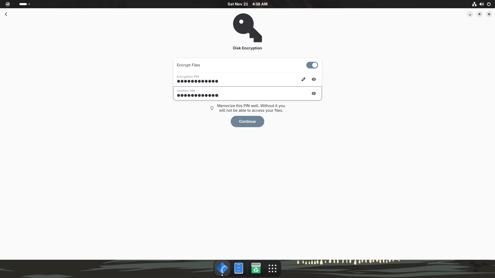 |
| Installer: confirm | ✅ | 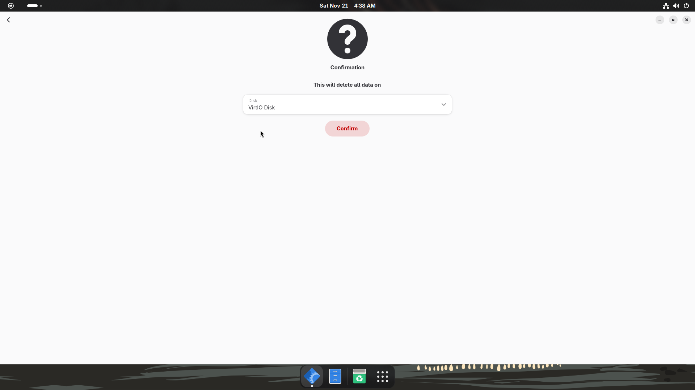 |
| Installer: summary | ✅ | 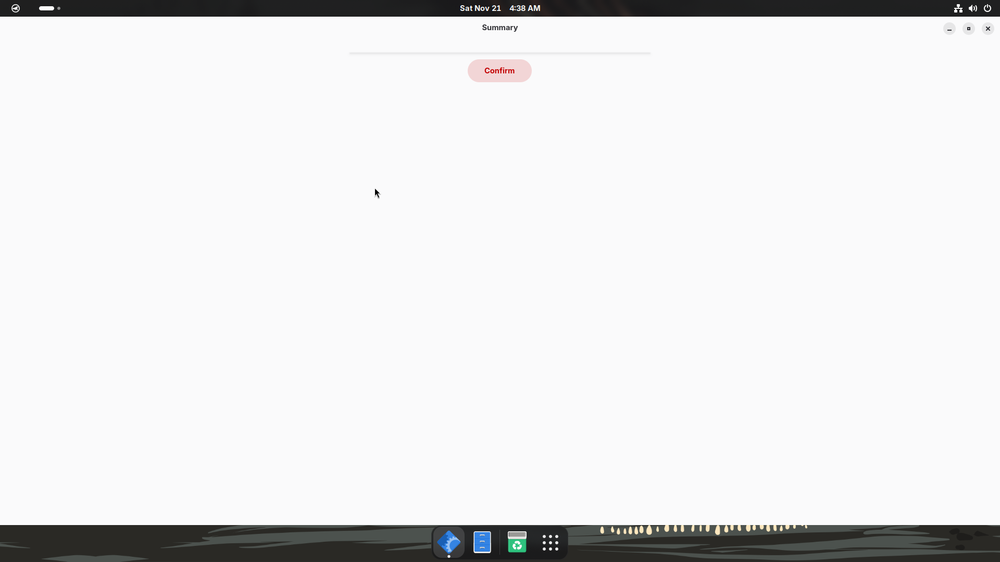 |
| Installer: progress | ✅ | 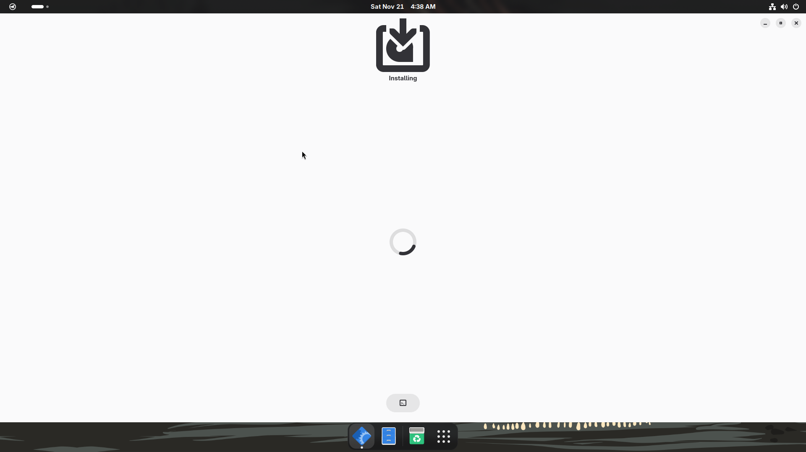 |
| Installer: done, 145 s after Confirm | ✅ | 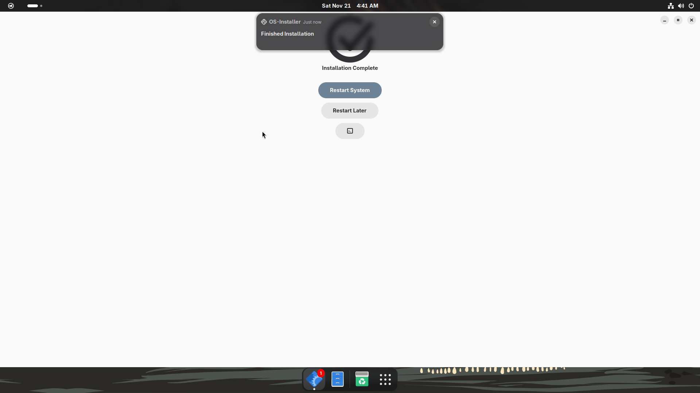 |
| Installer: terminal output ("Utah installed to /dev/vdb in 144s") | ✅ | 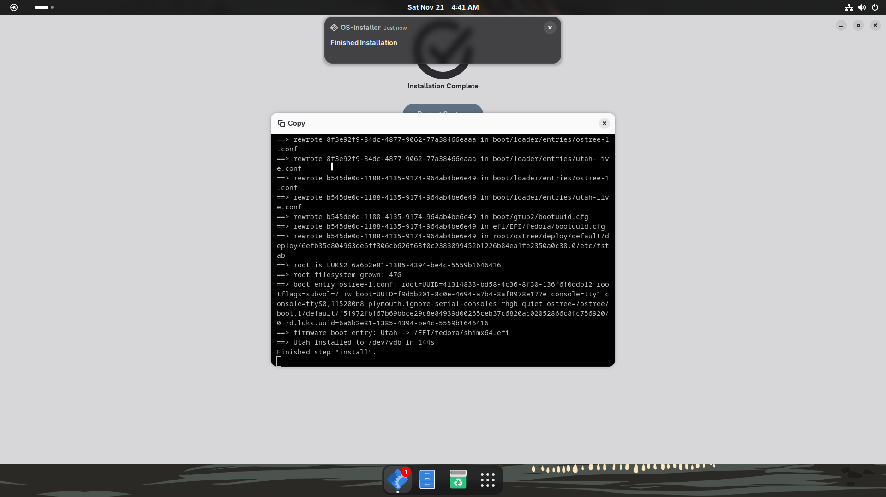 |
| Reboot into the installed disk: graphical, branded Plymouth LUKS prompt | ✅ |  |
| gnome-initial-setup: welcome | ✅ |  |
| gnome-initial-setup: About You (Utah Tester / tester) | ✅ |  |
| gnome-initial-setup: password | ✅ | 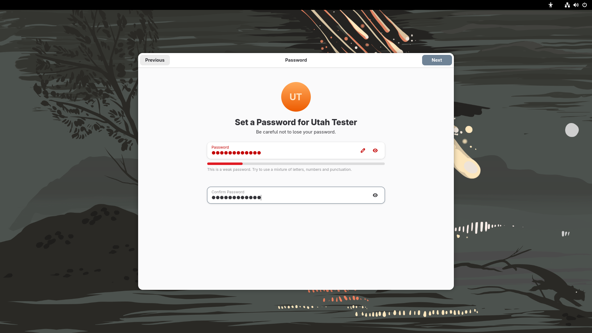 |
| gnome-initial-setup: all done | ✅ |  |
| First-boot desktop, terminal running `bootc status` (booted `:testing`, testing-20261120) | ✅ |  |
| `bootc switch` to the next `:testing` digest → reboot → LUKS prompt | ✅ |  |
| GDM greeter with the account gnome-initial-setup created | ✅ | 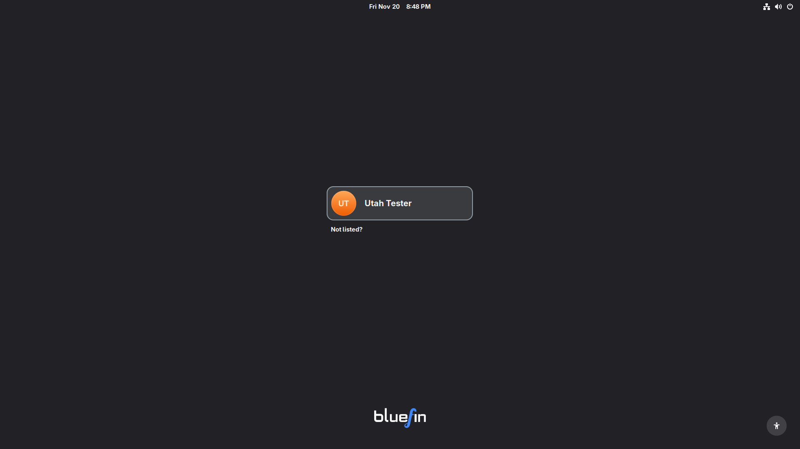 |
| Desktop + `bootc status` (booted `@sha256:b062118d…`, testing-20261121) | ✅ | 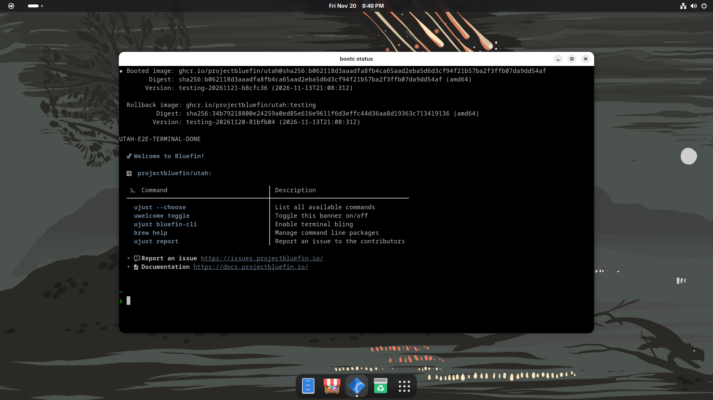 |
| `bootc rollback` → reboot → LUKS prompt | ✅ |  |
| GDM greeter | ✅ |  |
| Desktop + `bootc status` (booted the installed digest again) | ✅ | 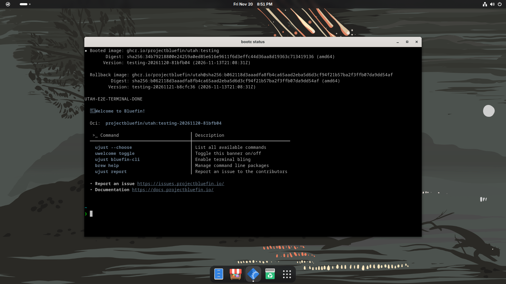 |

Facts from the same run (`run-44866213203-gui/facts-*.txt`):
- SELinux is Enforcing on every installed boot and `systemctl --failed` is empty;
- root is btrfs on `/dev/mapper/luks-<uuid>` and `/boot` is ext4, read-only;
- `rd.luks.uuid` and crypttab survive the switch and the rollback.

`run-44866213203-gui/utah-install.log` has the full install script output: repart block copy into LUKS2 (138 s), new vfat/ext4/btrfs UUIDs, reference
rewrites, and the firmware entry.

## Full screenshot tables

### GUI install (OS-Installer driven by USB-tablet clicks)

Run [44866213203](https://github.com/hanthor/utah/actions/runs/44866213203), `gui` install, files in [`run-44866213203-gui/`](run-44866213203-gui/).

| Screenshot | What it proves |
|---|---|
|  `00-grub-menu.png` | Firmware -> shim -> GRUB on the medium; 'Utah Live' BLS entry is the default |
|  `01-live-session.png` | Raw disk image booted as live media (utah.live, tmpfs overlay): GNOME session for the live user |
|  `02-installer-language.png` | OS-Installer autostarted in the live session: language page |
|  `03-installer-welcome.png` | Welcome page with the Utah logo and config text |
|  `04-installer-keyboard.png` | Keyboard layout page |
|  `05-installer-disk.png` | Disk selection: the empty 48 GB target /dev/vdb is offered; the 24 GB live medium is too small to pick |
|  `06-installer-encryption.png` | Encryption enabled with a passphrase (LUKS2 via systemd-repart Encrypt=key-file) |
|  `07-installer-confirm.png` | Confirmation: the target disk will be erased |
|  `08-installer-summary.png` | Summary page; the install script is already running in the background |
|  `09-installer-progress.png` | Install running: block copy of the live medium onto the target |
|  `10-installer-done.png` | Installation complete page |
|  `11-installer-log.png` | OS-Installer's terminal view: repart block copy into LUKS2, UUID regeneration, live entry removed, timings |
|  `12-first-boot-luks-prompt.png` | first boot: graphical, Bluefin-branded Plymouth LUKS passphrase prompt (plymouth-prompt.py exit 0) |
|  `13-gis-00-welcome.png` | gnome-initial-setup on the installed system: Welcome! |
| 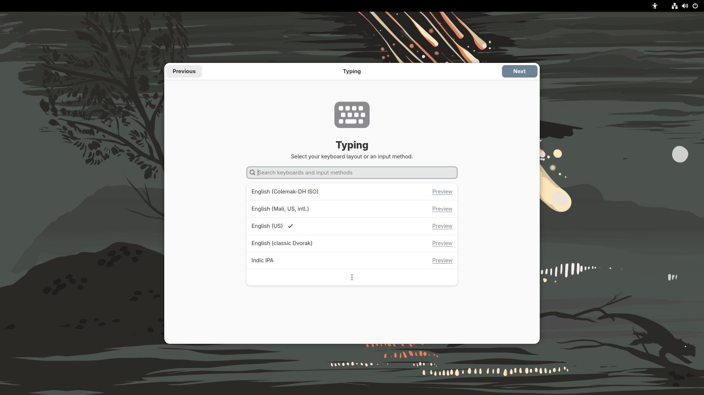 `13-gis-01-typing.png` | gnome-initial-setup on the installed system: Typing |
| 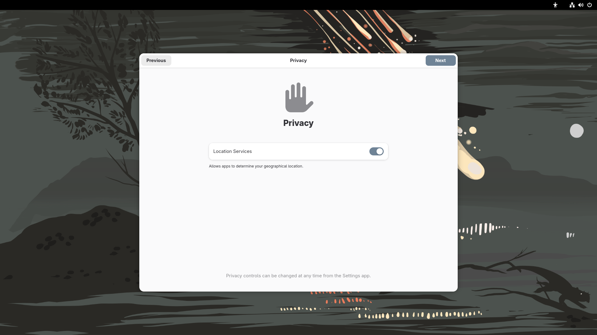 `13-gis-02-privacy.png` | gnome-initial-setup on the installed system: Privacy |
| 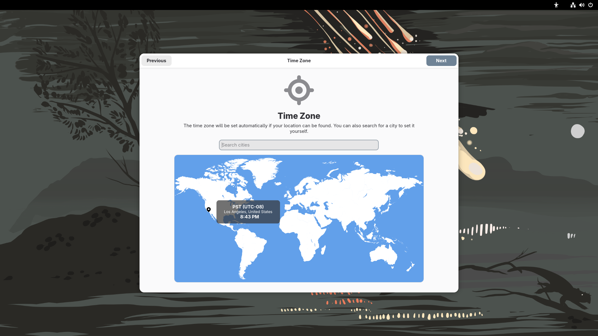 `13-gis-03-time-zone.png` | gnome-initial-setup on the installed system: Time Zone |
|  `13-gis-04-about-you.png` | gnome-initial-setup on the installed system: About You |
|  `13-gis-05-set-a-password-for-utah-tester.png` | gnome-initial-setup on the installed system: Set a Password for Utah Tester |
|  `13-gis-06-all-done.png` | gnome-initial-setup on the installed system: All done! |
| 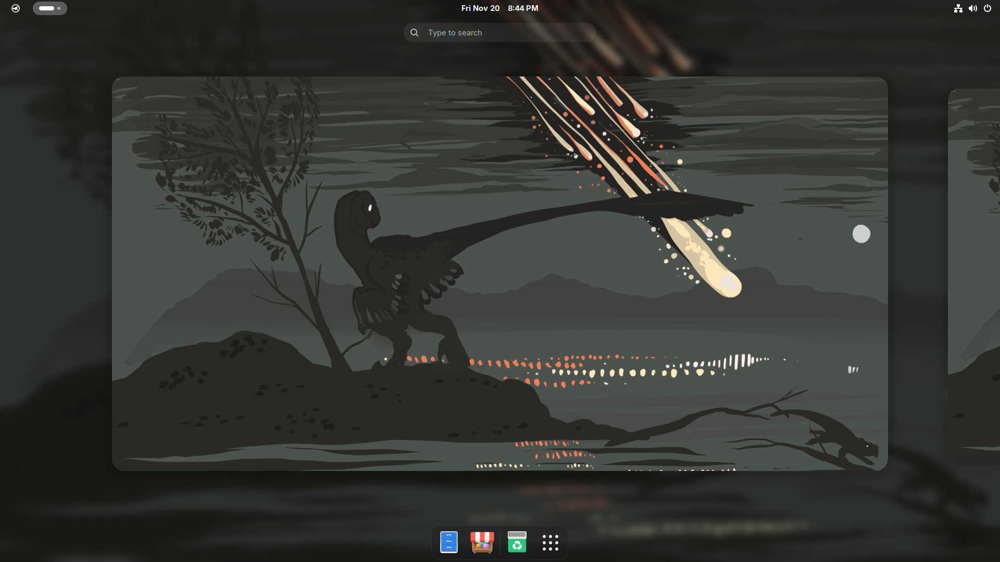 `14-first-boot-desktop.png` | first boot: GNOME desktop for tester |
|  `14-first-boot-bootc-status.png` | first boot: terminal on the desktop running `bootc status` |
|  `20-switch-luks-prompt.png` | after bootc switch: graphical, Bluefin-branded Plymouth LUKS passphrase prompt (plymouth-prompt.py exit 0) |
|  `21-switch-gdm.png` | after bootc switch: GDM greeter offers the account created by gnome-initial-setup |
| 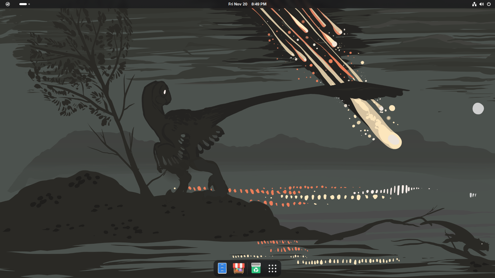 `22-switch-desktop.png` | after bootc switch: GNOME desktop for tester |
|  `22-switch-bootc-status.png` | after bootc switch: terminal on the desktop running `bootc status` |
|  `30-rollback-luks-prompt.png` | after bootc rollback: graphical, Bluefin-branded Plymouth LUKS passphrase prompt (plymouth-prompt.py exit 0) |
|  `31-rollback-gdm.png` | after bootc rollback: GDM greeter offers the account created by gnome-initial-setup |
|  `32-rollback-desktop.png` | after bootc rollback: GNOME desktop for tester |
|  `32-rollback-bootc-status.png` | after bootc rollback: terminal on the desktop running `bootc status` |

### Script install (same install.sh over SSH)

Run [44866213203](https://github.com/hanthor/utah/actions/runs/44866213203), `script` install, files in [`run-44866213203-script/`](run-44866213203-script/).

| Screenshot | What it proves |
|---|---|
|  `00-grub-menu.png` | Firmware -> shim -> GRUB on the medium; 'Utah Live' BLS entry is the default |
|  `01-live-session.png` | Raw disk image booted as live media (utah.live, tmpfs overlay): GNOME session for the live user |
| 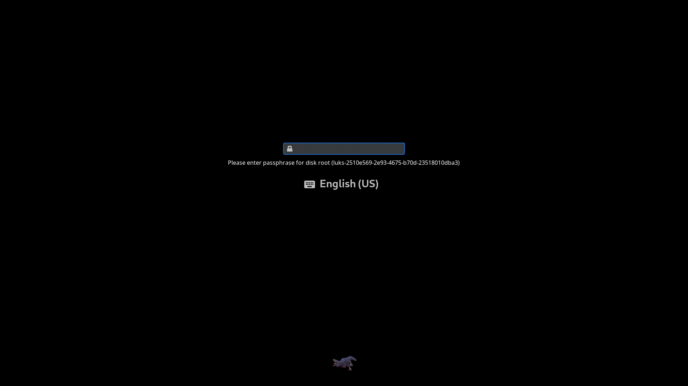 `12-first-boot-luks-prompt.png` | first boot: graphical, Bluefin-branded Plymouth LUKS passphrase prompt (plymouth-prompt.py exit 0) |
| 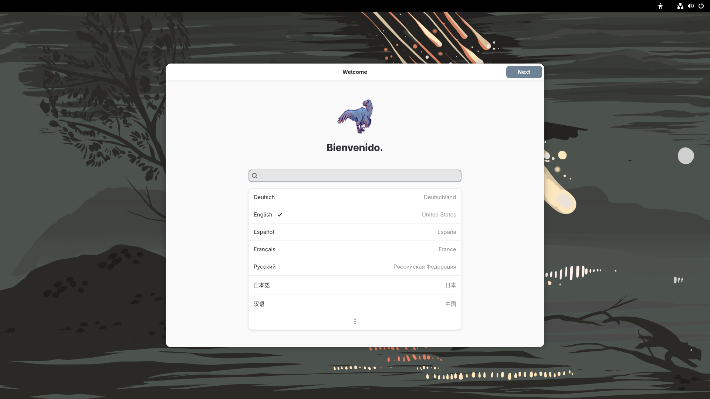 `13-gis-00-welcome.png` | gnome-initial-setup on the installed system: Welcome! |
|  `13-gis-01-typing.png` | gnome-initial-setup on the installed system: Typing |
|  `13-gis-02-privacy.png` | gnome-initial-setup on the installed system: Privacy |
|  `13-gis-03-time-zone.png` | gnome-initial-setup on the installed system: Time Zone |
| 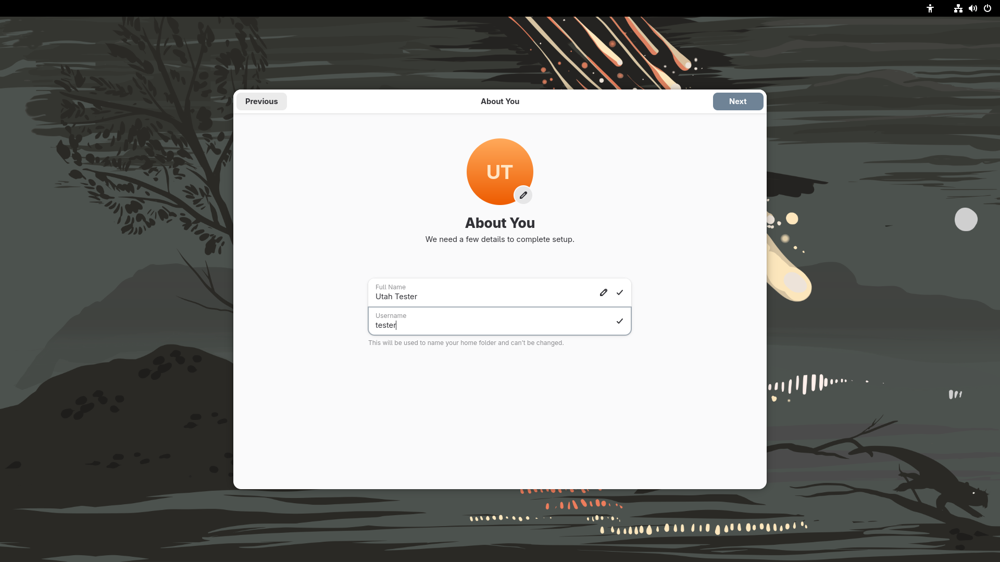 `13-gis-04-about-you.png` | gnome-initial-setup on the installed system: About You |
|  `13-gis-05-set-a-password-for-utah-tester.png` | gnome-initial-setup on the installed system: Set a Password for Utah Tester |
| 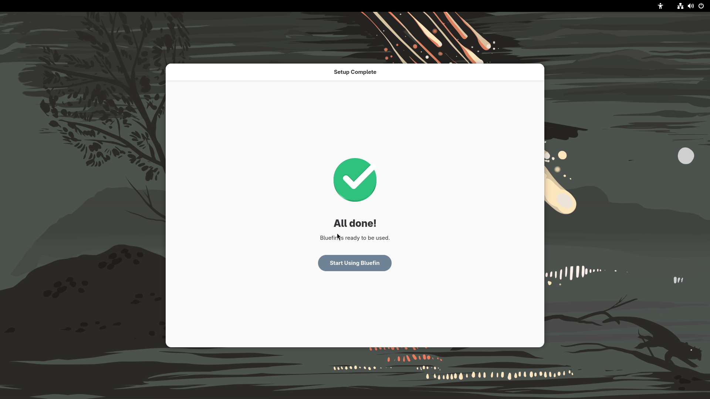 `13-gis-06-all-done.png` | gnome-initial-setup on the installed system: All done! |
|  `14-first-boot-desktop.png` | first boot: GNOME desktop for tester |
| 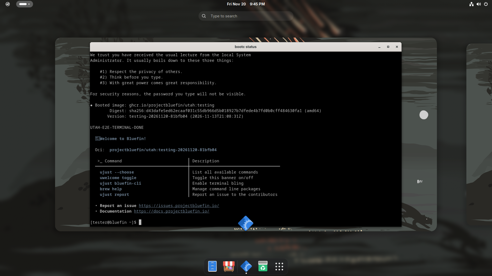 `14-first-boot-bootc-status.png` | first boot: terminal on the desktop running `bootc status` |
|  `20-switch-luks-prompt.png` | after bootc switch: graphical, Bluefin-branded Plymouth LUKS passphrase prompt (plymouth-prompt.py exit 0) |
|  `21-switch-gdm.png` | after bootc switch: GDM greeter offers the account created by gnome-initial-setup |
| 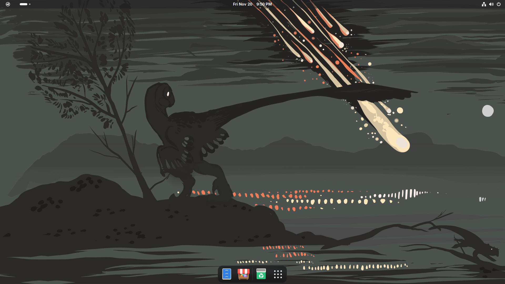 `22-switch-desktop.png` | after bootc switch: GNOME desktop for tester |
| 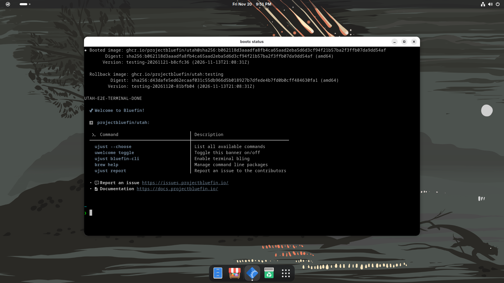 `22-switch-bootc-status.png` | after bootc switch: terminal on the desktop running `bootc status` |
|  `30-rollback-luks-prompt.png` | after bootc rollback: graphical, Bluefin-branded Plymouth LUKS passphrase prompt (plymouth-prompt.py exit 0) |
|  `31-rollback-gdm.png` | after bootc rollback: GDM greeter offers the account created by gnome-initial-setup |
|  `32-rollback-desktop.png` | after bootc rollback: GNOME desktop for tester |
|  `32-rollback-bootc-status.png` | after bootc rollback: terminal on the desktop running `bootc status` |

### Earlier runs

- [44864314405](https://github.com/hanthor/utah/actions/runs/44864314405): first full GUI install; the installed disk then asked for the passphrase in Plymouth's text mode (no `rhgb quiet` on the deployment), fixed in the next run.
- [44863382769](https://github.com/hanthor/utah/actions/runs/44863382769): pointer clicks reach the installer, but one row low (the maximized window starts under the top bar, not above the dock).
- [44859743707](https://github.com/hanthor/utah/actions/runs/44859743707): keyboard-only driving; the installer window never had focus.

### Run [44857364700](https://github.com/hanthor/utah/actions/runs/44857364700)

| Screenshot | What it proves |
|---|---|
|  `00-grub-menu.png` | Firmware → shim → GRUB on the raw medium boots the default "Utah Live (try or install)" BLS entry |
|  `01-live-session.png` | The installed-disk image booted as live media (`ro utah.live`, tmpfs overlay, SELinux **enforcing**, medium attached read-only) reaches a GNOME session for the live user, with OS-Installer autostarted |
|  `02-installer-language.png` | OS-Installer (hanthor/os-installer `utah` config) running in the live session, language page |
|  `fail-final.png` | Where the run stopped: the harness could not activate a list row through AT-SPI (GTK 4 exposes no row actions or GrabFocus), fixed in later runs by keyboard navigation |

`live-facts.txt` shows `/sysroot` as an overlay over the read-only `vda3`, the composefs root, `getenforce` = Enforcing and `vda` RO=1.
